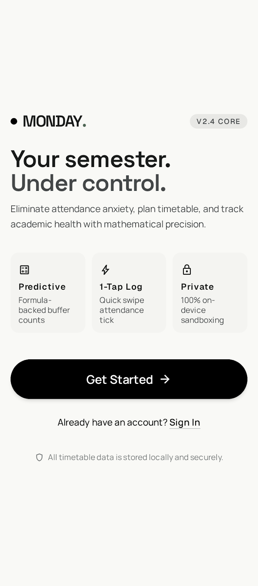
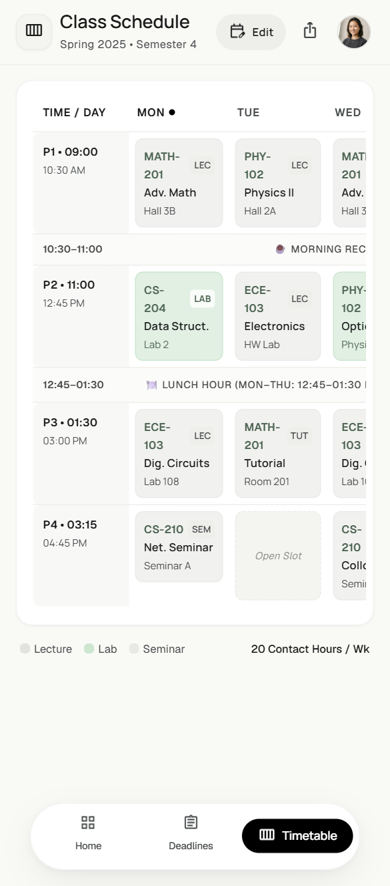
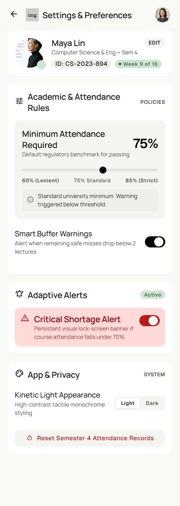

# MONDAY — Smart Attendance Tracker

A full-stack, multi-user Smart Attendance Tracker built around the **Kinetic Glass Minimalist** Google Stitch UI. Track per-subject attendance, calculate safe bunk limits and recovery paths automatically, manage weekly timetables (including breaks and lunch slots), and monitor academic deadlines.

---

## Screenshots

| Onboarding & Auth | Weekly Timetable | Settings & Preferences |
| :---: | :---: | :---: |
|  |  |  |

---

## Features

- **Multi-User Authentication & Isolation**: Registration, login, JWT session tokens, `bcryptjs` password hashing, strict per-user data isolation, and self-service account deletion (`DELETE /api/auth/me`).
- **Intelligent Attendance Calculation Engine**:
  - Per-subject and weighted overall attendance (`sum(attended) / sum(total)`).
  - Consecutive classes required to reach target (`(A + x) / (T + x) >= R`).
  - Safe bunk calculator (`A / (T + x) >= R`, never negative).
  - Future attendance projection & estimated recovery date calculation.
- **Subject & Attendance Management**: Custom attendance thresholds per subject, 1-tap Attended/Missed logging, manual past entry/editing, duplicate prevention, and `attendance_audit_log` tracking.
- **Weekly Timetable & `.ics` Export**: Matrix view supporting Lectures, Labs, Tutorials, Seminars, **Break / Recess**, and **Lunch Break** slots, plus `.ics` calendar export.
- **Deadlines & Alerts**: Track assignments, labs, projects, and exams; automated shortage and low-buffer notifications.
- **Legal & Compliance**: Built-in `/privacy` and `/terms` pages.

---

## Tech Stack

- **Frontend**: Vanilla JS SPA, Tailwind CSS, Space Grotesk / Manrope / Geist typography, Material Symbols.
- **Backend**: Node.js (v24+), Express, Helmet, CORS, Rate Limiting, `express-validator`, `bcryptjs`, `jsonwebtoken`.
- **Database**: SQLite via Node.js built-in `node:sqlite` (`DatabaseSync` with WAL mode & foreign keys).
- **Cloud-Ready Backend (Included)**: Complete Supabase PostgreSQL migrations with Row Level Security (`supabase/migrations/001_initial_schema.sql`) and Supabase Edge Functions (`supabase/functions/`).

---

## Local Installation & Setup

### Prerequisites
- **Node.js v24.0.0+** and **npm**

### Steps

1. **Clone the repository**:
   ```bash
   git clone https://github.com/<your-username>/Attendance_tracker.git
   cd Attendance_tracker
   ```

2. **Install dependencies**:
   ```bash
   npm install
   ```

3. **Configure environment variables**:
   Copy `.env.example` to `.env` and set a strong `JWT_SECRET`:
   ```bash
   cp .env.example .env
   ```

4. **Run database migrations**:
   ```bash
   npm run db:migrate
   ```

5. **Run automated tests**:
   ```bash
   npm test
   ```

6. **Start the server**:
   ```bash
   npm start
   ```
   Open [http://localhost:3000](http://localhost:3000) in your browser.

---

## Database Migrations & Backups

- **Migrate**: `npm run db:migrate` applies `database/schema.sql` and upgrades existing schemas safely.
- **Backup**: `npm run db:backup` checkpoints the SQLite WAL and saves a timestamped copy in `backups/`.

---

## Cloud Deployment (Supabase + Firebase)

For public multi-user production hosting where end users do not configure their own backend:

1. **Supabase Configuration**:
   - See [`supabase/README.md`](supabase/README.md) for linking your project and pushing `supabase/migrations/001_initial_schema.sql` (PostgreSQL schema, RLS policies, audit triggers, and indexes).
   - Deploy the Edge Functions in `supabase/functions/attendance-engine` and `supabase/functions/notifications`.
   - Never expose `SUPABASE_SERVICE_ROLE_KEY` in client code; only use `SUPABASE_ANON_KEY` with RLS enabled.
2. **Firebase Cloud Messaging (FCM)**:
   - Create a Firebase project and obtain your FCM Server Key.
   - Set it as a Supabase secret:
     ```bash
     supabase secrets set FCM_SERVER_KEY=<your-fcm-server-key>
     ```
3. **Express Production Hosting**:
   - See [`DEPLOYMENT.md`](DEPLOYMENT.md) for environment variables, SMTP password recovery setup, error logging (`logs/error.log`), and Play Store legal URLs (`/privacy` and `/terms`).

---

## Automated Testing & CI

- Run the full unit and integration suite locally:
  ```bash
  npm test
  ```
- GitHub Actions (`.github/workflows/ci.yml`) automatically runs `npm ci`, `npm run db:migrate`, and `npm test` on every push and pull request to `main`/`master`.

---

## Contributing

Contributions are welcome! Please read [`CONTRIBUTING.md`](CONTRIBUTING.md) before submitting a pull request.

## License

Copyright (c) 2026 Prathul P. All Rights Reserved.  
This project is governed by the **Monday – Proprietary Software Licence** — see [`LICENSE`](LICENSE) for details.
